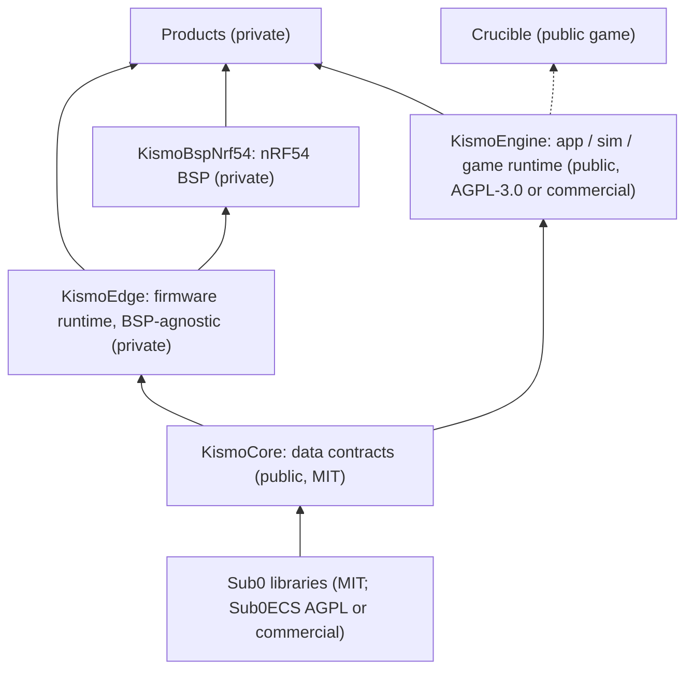

# 0001: Kismo platform layering

- **Status:** Accepted (2026-10-14)
- **Owner:** Craig Hutchinson (copyright holder of all Kismo, Sub0 and product code)
- **Origin:** drafted in the product-side decision records (private); this is now the canonical cross-repo record

## Context

Several projects need the same foundations:

- **Two device products on Nordic nRF54** need deterministic acquisition, a power-fail-safe record journal,
  a versioned record codec, offload, time sync and power management.
- **Apps, a simulator and games** need a deterministic fixed-step runtime with replay.

Much of this is already proven in [Crucible](https://github.com/CraigHutchinson/Crucible) and in the
products. Both build on the [Sub0 libraries](https://github.com/CraigHutchinson/.github/tree/main/docs).

## Decision

Read each arrow as "is used by"; dashed means planned.

| Layer | Contents | Excludes |
|---|---|---|
| **KismoCore** | Channels, units, rates, provenance; record framing, codec and journal format; time base and sync; `Source` / `Clock` / `RecordStore` / `Transport` concepts and fakes; replay; C++ and Python decoders | RTOS / OS code, drivers, product schemas |
| **KismoEngine** | Fixed-step deterministic loop, command admission, ECS world, terrain / world model, owned snapshots, trace replay, headless runner, render / client adapters, WASM and Python bindings | Game rules, content, product models |
| **KismoEdge** | Zephyr / NCS runtime: journal on storage, offload, time sync, power policy, inference runner, generic drivers. It **defines the BSP contract** and contains no SoC or board code | Product algorithms, models, boards |
| **KismoBspNrf54** | nRF54L15 / nRF54LM20A SoC and NCS integration; dev-kit and module boards. It implements the BSP contract | Product PCBs (they stay in product repos) |
| **Products** | Product schemas, sensors, algorithms, trained models, boards, apps, content, services | — |

### Rules

1. **One-way dependencies.** Closed code may depend on open code, never the reverse. Lower layers never
   depend on higher ones, so Sub0 knows nothing of Kismo.
2. **Forge rule.** Code is born in a real consumer. It moves down a layer only when a second consumer needs
   it and it has tests. Extract with history, and keep one source of truth.
3. **Pins, not HEADs.** Consumers pin exact versions: CPM full pins, and `west` revisions for firmware.
4. **No product IP in open repos.** Generic maths and formats are open. How a product senses or decides
   (features, thresholds, models, sensor geometry) stays closed.

### Licences

| Repository | Licence | Why |
|---|---|---|
| KismoCore | MIT | It is the data contract, so adoption should be frictionless, including in closed firmware and tools. Commercial users are *asked*, not required, to get in touch |
| KismoEngine | AGPL-3.0-only or commercial | Open use is free. Closed products, private modifications and hosted services take a commercial licence. This matches Sub0ECS |
| KismoEdge, KismoBspNrf54 | Proprietary | Firmware know-how stays private for now. Opening later is cheap; closing later is not |

KismoEngine contributions carry inbound terms: a DCO sign-off, plus a grant to the copyright holder and
successors / assigns, so dual licensing stays possible. KismoCore needs only a DCO.

### BSP boundary (open design)

KismoEdge must work with, and be extendable by, different BSPs. KismoBspNrf54 is the first; a host
`native_sim` BSP for CI is planned.

Candidate mechanisms, which may be combined:

- devicetree `chosen` nodes plus Kconfig;
- C++ concepts over Zephyr devices;
- generic Zephyr driver APIs;
- `west` module composition.

Open questions:

- how to split by SoC family vs vendor SDK;
- how part-specific capabilities are declared;
- how the contract and each BSP are versioned against each other.

## Consequences

- Each repository links here from its README, and records its own consequences in its own decision log.
- The first code arrives by extraction:
  - the device foundations into KismoCore / KismoEdge;
  - the runtime loop from Crucible into KismoEngine, once a second consumer needs it.
